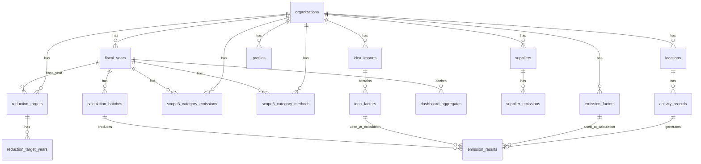

# OpenGreenTrack 機能仕様書

本書は OpenGreenTrack の**現行の機能仕様**（画面・列挙型・バリデーション規則・算定ロジック）を定義する。

関連正本:

| 領域 | 正本 |
|---|---|
| 開発規約・技術スタック | [`AGENTS.md`](../AGENTS.md) |
| アーキテクチャ | [`architecture.md`](./architecture.md) |
| DB 物理設計（全カラム定義） | [`database-design.md`](./database-design.md) |
| 算定ロジックの詳細 | [`calculation-logic.md`](./calculation-logic.md) |
| Scope 3 積上げ（IDEA 連携） | [`idea-scope3-spec.md`](./idea-scope3-spec.md) |

本書はフィールドの全定義を重複して持たない。カラム単位の定義は `database-design.md` を参照すること（DDL の最終正本は `supabase/migrations/*_schema.sql`）。

---

## 1. 目的とスコープ

OpenGreenTrack は、企業の温室効果ガス（GHG）排出量を算定・可視化・管理する Web アプリケーションである。Scope 1 / 2 / 3 を横断し、脱炭素経営の意思決定を支援する。

**想定ユーザー**: 環境推進部門・サステナビリティ担当、拠点のエネルギー管理責任者、経営層。

### 1.1 対応範囲

| 区分 | 対応内容 |
|---|---|
| 認証 | Supabase Auth（メール + パスワード）。招待によるメンバー追加、パスワード再設定。ロールは管理者（`profiles.role = 'admin'`）とメンバー（それ以外）の 2 つ（§4.8.1） |
| マルチテナント | `organizations` 単位。全テーブルを RLS で組織スコープに閉じる |
| Scope 1 / 2 | 活動量 × 排出係数で算定。電気・都市ガス・熱・各種燃料に対応 |
| Scope 3 | カテゴリ（1〜15）ごとに **direct（直接入力）** と **calculated（IDEA 原単位の積上げ）** を排他選択（§4.3.3 / §7.2） |
| データ入力 | 手動入力のみ（`SourceType` は `manual` の 1 値）。電気・都市ガス・燃料の請求書は AI でまとめて読み取り、表で確かめて登録するか、フォームに候補を入れられる（保存は人が確かめてから行う。§4.2.4）。記録ごとに帳票（請求書など）のファイルを残せる（§4.2.5）。活動量のファイル取込は持たない |
| 削減目標 | 基準年度 + 年度ごとの削減率（%）。年間目標は「基準年度の実績 × (1 − 削減率/100)」で導出する |
| レポート | PDF（印刷ビュー）と CSV。**社内確認・共有を想定した独自様式であり、制度の提出様式ではない** |

**対象ガスは実質的に CO2 のみ**（同梱の公式係数がすべて CO2 対象。CH4 / N2O / フロン類を入力・算定する仕組みは無い）。Scope 2 はマーケット基準／ロケーション基準の基準別算定・表示に対応する（Scope 分析画面。`calculation-logic.md` §4）が、証書・クレジットの反映（環境価値の控除）は未実装。

### 1.2 共通コンテキスト

全画面で以下を前提とする。

| 項目 | フィールド | 説明 |
|---|---|---|
| 組織 | `organizationId` | テナント識別子。RLS で強制される |
| 算定年度 | `fiscalYearId` | ヘッダーで切り替える。表示・集計の基準 |
| 表示単位 | — | t-CO2e 固定 |

**算定年度（`fiscal_years`）**: `label`（例 `2024年度`）、`startDate` / `endDate`。開始月は組織設定（`organizations.fiscalYearStartMonth`）で変更でき、4月始まり以外も選べる。「現在の年度」は DB のフラグではなく**今日の日付が期間に含まれるか**で判定する（`isCurrentFiscalYear`）。画面の既定選択は最新年度（`startDate` 降順の先頭）。

---

## 2. ドメインモデル



図は外部キーのある関係だけを描く。`scope3_category_methods` と `scope3_category_emissions` は `organizationId` + `fiscalYearId` + `categoryId` で突き合わせるが、両者の間に外部キーは無い。

| エンティティ | 説明 |
|---|---|
| `locations` | 拠点マスタ |
| `emission_factors` | 排出係数（公式マスタ・組織カスタム）。`organizationId` が null の行は全組織共通の読み取り専用マスタ |
| `activity_records` | 活動量（電気 kWh、ガス m³ 等）。Scope 3 積上げ行は `energyType='scope3_activity'` |
| `emission_results` | 算定結果（t-CO2e）。`activityRecordId` に UNIQUE 制約（二重計上防止） |
| `calculation_batches` | 算定ジョブ |
| `idea_imports` / `idea_factors` | IDEA データベース由来の Scope 3 原単位。精度・規模・ライセンス境界の都合で `emission_factors` とは別テーブル |
| `scope3_category_emissions` | Scope 3 カテゴリ別の直接入力値 |
| `scope3_category_methods` | カテゴリごとの算定方式（`direct` / `calculated`）の選択状態 |
| `suppliers` / `supplier_emissions` | サプライヤー別の Scope 3 実排出量（1次データ）。表示専用で `scope3Total` には算入しない |
| `reduction_targets` / `reduction_target_years` | 削減目標。組織あたり 1 行の基準年度と、年度ごとの削減率（%） |
| `dashboard_aggregates` | ダッシュボード用の集計キャッシュ |
| `system_audit_logs` | 監査ログ。レポート生成履歴もここに記録する |

---

## 3. 列挙型・マスタ

値は DB の enum 型（`supabase/migrations/*_schema.sql`）と `src/features/calculation/types.ts` が正本。

### 3.1 Scope

`scope1` / `scope2` / `scope3`

### 3.2 エネルギー種別（EnergyType）

**手動入力の選択肢**（`MANUAL_ACTIVITY_CATEGORIES`。単位は種別に連動し編集不可）

| 値 | 表示名 | 単位 |
|---|---|---|
| `electricity` | 電気 | kWh |
| `city_gas` | ガス | m³ |
| `heat` | 熱（温水・冷水・蒸気） | GJ |
| `waste` | 廃棄物 | t |
| `fuel_gasoline` | ガソリン | L |
| `fuel_diesel` | 軽油 | L |
| `fuel_kerosene` | 灯油 | L |
| `fuel_heavy_oil` | 重油 | L |
| `fuel_lpg` | LPG | t |
| `fuel` | 燃料（その他） | L |
| `business_travel` | 出張 | 人・日 |
| `business_travel_commuting` | 通勤 | 人・日 |

ガソリン・軽油・灯油・重油・LPG は、公式係数を細目の種別（`fuel_gasoline` など）で同梱している。係数候補は energyType の完全一致で絞るため、細目を選択肢に置かないと「燃料（その他）」（`fuel`。コークス・タール・廃プラスチック類など 17 種）を選んでもガソリンなどの係数が候補に出ない。重油は A重油と B・C重油が同じ優先度の候補になるため、入力フォームは自動で選ばず、候補から選ぶまで保存できない（§4.2.1）。LPG は公式係数が `tCO2/t` のため重さ（t）で入力する。

出張（Scope 3 カテゴリ6）と通勤（カテゴリ7）は別カテゴリ。係数候補は energyType の完全一致で絞るため、1 本にまとめると通勤の係数だけが候補になり、出張の代表原単位（12 件）に到達できない（#381）。

`business_travel_commuting` の単位が距離（km）でなく延べ人日なのは、公式係数（環境省 排出原単位DB カテゴリ7 通勤）がすべて `kg-CO2/人・日` のため。km で保存すると換算できず恒久的に `UNIT_MISMATCH` になる。`business_travel` も標準単位は延べ人日（公式係数「延べ出張日数当たり」`t-CO2/人・日`）だが、交通費支給額当たり（`kg-CO2/円`）・宿泊数当たり（`kg-CO2/泊`）・従業員当たり（`t-CO2/人・年`）の係数を選ぶと、入力フォームが係数の分母単位（円 / 泊 / 人・年）で活動量を入力させる（`resolveEntryUnit`）。

**手動入力の選択肢外**（ラベルのみ保持。登録済みレコードの履歴表示と、排出係数管理の種別表示に使う）

公式係数が 1 件も無く、選んでも未算定のままになる 4 種:
`vehicle`（車両 km） `logistics`（物流 t-km） `purchased_goods_services`（購入した製品・サービス 円） `supplier_data`（サプライヤーデータ t-CO2e）

> 物流・購入した製品・サービスは IDEA 原単位（Scope 3 積上げ）から入力する。車両はガソリン・軽油（L）で入力する（距離ベースの推計は燃料との二重計上の入口になるため）。

その他:
`water`（水道 m3） `freight_transport`（輸送 t-km）

温対法「算定方法・排出係数一覧」の燃料のうち、手動入力の選択肢に無い細目:
`fuel_crude_oil`（原油 L） `fuel_naphtha`（ナフサ L） `fuel_jet`（ジェット燃料油 L） `fuel_lng`（LNG t） `fuel_natural_gas`（天然ガス m³） `fuel_coal`（石炭 t）

**Scope 3 積上げ専用**

`scope3_activity` — IDEA 連携の積上げレコード。カテゴリ識別は `activity_records.scope3CategoryId` が担う。**係数作成 UI・係数 CSV 取込の種別候補からは除外する**（カスタム係数が積上げ行に自動マッチする経路を塞ぐため）。

### 3.3 算定バッチステータス（BatchStatus）

`pending`（実行中） / `completed`（完了） / `failed`（失敗）

`pending` のまま滞留したバッチは、次のバッチ作成時に `failed` へ回収される（プロセス消失で年度の算定が恒久的に止まらないようにするため）。

### 3.4 拠点ステータス（LocationStatus）

`active`（稼働中） / `paused`（一時停止） / `preparing`（準備中） / `closing`（閉鎖予定）

### 3.5 入力元種別（SourceType）

`manual`（手動入力）のみ。活動量のファイル取込は持たないため 1 値だけの enum になっている。

### 3.6 係数ステータス（FactorStatus）

`active`（有効） / `pending_review`（確認中） / `draft`（下書き） / `archived`（アーカイブ済み・一覧非表示）

### 3.7 係数データソース（FactorSource）

`moe`（環境省） / `meti`（経済産業省） / `ketsoho`（温対法） / `utility`（事業者別排出係数） / `custom`（自社設定）

### 3.8 係数種別（FactorType）

`basic`（基礎排出係数） / `adjusted`（調整後排出係数）。区分を持たない係数（燃料・Scope 3 原単位・カスタム係数）は null。

### 3.9 Scope 3 カテゴリ

| ID | 表示名 |
|---|---|
| 1 | 購入した製品・サービス |
| 2 | 資本財 |
| 3 | Scope 1,2 に含まれない燃料及びエネルギー |
| 4 | 輸送、配送（上流） |
| 5 | 事業から出る廃棄物 |
| 6 | 出張 |
| 7 | 雇用者の通勤 |
| 8 | リース資産（上流） |
| 9 | 輸送、配送（下流） |
| 10 | 販売した製品の加工 |
| 11 | 販売した製品の使用 |
| 12 | 販売した製品の廃棄 |
| 13 | リース資産（下流） |
| 14 | フランチャイズ |
| 15 | 投資 |

### 3.10 Scope 3 算定方式（Scope3Method）

`direct`（直接入力） / `calculated`（積上げ）。カテゴリごとに排他選択する。将来 `hybrid` を値追加で拡張可能。

### 3.11 地域（Region）

`Hokkaido`（北海道） `Tohoku`（東北） `Kanto`（関東） `Chubu`（中部） `Kansai`（関西） `Chugoku_Shikoku`（中国・四国） `Kyushu`（九州） `Overseas`（海外）

### 3.12 拠点種別（LocationType）

`headquarters`（本社） `branch`（支社） `factory`（工場） `office`（オフィス） `logistics`（物流拠点） `service`（サービス拠点） `other`（その他）

### 3.13 IDEA 取込ステータス（IdeaImportStatus）

`processing` / `completed` / `failed`

---

## 4. 画面別仕様

| URL | 画面 | 主なデータソース |
|---|---|---|
| `/dashboard` | ダッシュボード | `dashboard_aggregates`、`reduction_targets` |
| `/data-input` | データ入力 | `activity_records`、`emission_factors`、`idea_factors` |
| `/scope-analysis` | Scope 分析 | `scope3_category_methods`、`scope3_category_emissions`、`emission_results`、`supplier_emissions`、`dashboard_aggregates`（Scope 別構成・Scope 2 基準別） |
| `/factors` | 排出係数管理 | `emission_factors`、`idea_imports` |
| `/locations` `/locations/[locationId]` | 拠点管理 | `locations` |
| `/reports` `/reports/print` | レポート | 集計 RPC、`system_audit_logs`（履歴） |
| `/settings/company` `/settings/account` | 設定 | `organizations`、`profiles`、`fiscal_years`、`invites` |
| `/login` `/signup` `/forgot-password` `/reset-password` `/invite/[token]` | 認証 | Supabase Auth、`invites` |

### 4.1 ダッシュボード

KPI サマリ（総排出量・Scope 別・前年比）、月別推移（積上げ棒＋削減目標ライン）、Scope 3 内訳（カテゴリ別）、排出量上位拠点、削減目標カード。削減目標は独立した画面を持たず、このカードから設定する（§4.7）。

Scope 3 内訳は排出量の多い順に**上位 5 カテゴリ**を個別表示し、残りは「その他（N カテゴリ）」に束ねる。

排出量上位拠点（Scope 1・2 の合計・上位 5 拠点）は**拠点で絞り込んでいる間は表示しない**。組織全体のランキングであり拠点絞り込みが効かないため、選択拠点の値の横に他拠点の数値が並ぶと絞り込みが効いていないと誤読させるため。Scope 3 内訳・KPI の Scope 3 は拠点別に持てないため、絞り込み中も組織全体の値を「（組織全体）」の注記つきで表示する。

KPI カードの前年比ピルと排出量上位拠点テーブルの前年比列は、**色による良し悪しの断定を年度の終了日を過ぎた年度に限る**（削減目標カードの達成状況・基準年度比と同じ整理、§4.7）。分子が表示年度の期中累計・分母が前年度の通年実績のため、期中は実態より大きな「削減」に見える（期首・未入力なら `↓100.0%`）。期中は増減率と向き（`↑` / `↓`）は出したうえで `（期中）` を添えて中立色にする。前年度のデータが無ければ `前年比データなし`（中立）。

集計は `dashboard_aggregates` を参照する。キャッシュは算定確定時に **絶対値で再計算**（自己修復）される。Scope 3 内訳は**方式適用後の採用値**（direct を選んだカテゴリは direct 値、calculated を選んだカテゴリは積上げ値）に揃える。

### 4.2 データ入力

活動量の入力は**手動入力のみ**（`SourceType` は `manual` の 1 値）。請求書の AI 読取り（§4.2.4）は表・フォームに候補を入れるだけで、保存は人が確かめてから行う（表の「選んだ明細を登録」かフォームの入力プレビュー）。記録には根拠の帳票（請求書など）を紐づけて残せる（§4.2.5）。活動量のファイル取込は持たない。

#### 4.2.1 統合入力フォーム

1 つのフォームで Scope 1・2 と Scope 3 積上げの両方を入力する。カテゴリの選択で**係数の参照方式**が決まり、フォームの中身が切り替わる。

| 参照方式 | 対象カテゴリ | 係数の決まり方 |
|---|---|---|
| 供給事業者別 | 電気・ガス・熱 | 計算方法（基礎/調整後）→ 供給事業者 → メニュー を選ぶ。未選択なら全国の代替値。事業者の検索語を残したまま選択せずに検索を離脱（枠外クリック・Escape）すると、未選択＝代替値適用になることを警告で知らせる（再フォーカス・再入力・選択・カテゴリ変更で消える揮発表示） |
| 標準 | 廃棄物・燃料・出張・通勤 | 拠点・対象年月に合う標準係数を優先順位で自動選択。候補から変更も可。同じ優先度で名前の違う候補が並ぶとき（重油の A重油・B・C重油、燃料（その他）の 17 種、廃棄物の 12 種など）は自動で選ばず、候補から選ぶまで保存できない |
| IDEA 原単位 | Scope 3 カテゴリ 1〜15 | 製品をサーバーサイド検索で選ぶ。検索するのは対象年月が属する会計年度に割り当てた IDEA の版（無ければ有効な版）。選択中の製品がその版の製品でなければ選び直しを促す。単位は製品から自動設定（編集不可） |

入力項目は 拠点・カテゴリ・使用量・単位（種別に連動し編集不可）・対象年月（算定期間に連動した 年度 → 月 のプルダウン。V-ACT-002b）・備考。保存前に、**保存後の算定で実際に適用される係数**でインライン概算排出量を表示する（同じ純関数を使うため、プレビューと算定結果はずれない）。

拠点・カテゴリ・対象年月（Scope 3 積上げはさらに IDEA 製品）が揃った時点で、読み込み済みの入力履歴を保存時と同じ重複キーで照合し、同じ条件のレコードが登録済みなら活動量の入力前に「既に登録済み」の警告をフォーム内に表示する。新規入力では警告から「**既存のレコードを開く**」で該当レコードの編集モーダルを開き、合算入力へ直行できる（編集モーダルでは自分自身を除いて照合し、乗り換え導線は出さない）。警告はプレビュー・保存を止めない（別タブ・別ユーザーの登録で履歴が古い場合は検知できないため、確定判定は保存時の重複チェックに委ねる）。保存に成功した直後に対象年月を翌月へ送れない場合（当月・算定期間の末月）は、拠点・カテゴリ・対象年月を保持したまま今保存したレコードが履歴に加わるが、条件を変えるまでは同じ条件で警告しない。

保存後は活動量・備考をクリアし、**対象年月を翌月へ自動で送る**（当月まで。未来月と、年度マスタに登録済みの算定期間に属さない月には送らない。翌年度が未登録のまま年度末の月を保存したときは、算定期間外の月へ進めず年度末の月に留まる）。拠点・カテゴリ・係数/製品の選択は保持し、同一拠点の連続入力を「数量を打って保存」の繰り返しにする。

##### 複数月まとめて入力（一括入力）

新規入力では入力方法を**単月入力 / 複数月まとめて入力**で切り替えられる。一括入力は対象年月の代わりに**対象年度**（会計年度マスタ。単月入力の年度プルダウンと同じく、入力できる月を 1 つも持たない全月未来の年度は出さない）を選び、年度内の各月の使用量をグリッドで入力して一括保存する。

- 未来月は入力不可。空欄の月は登録しない。活動量の検証と入力フィルタは単月入力と同じ（V-ACT-001。0 は実績ゼロとして保存でき、確認モーダルの該当月に確認表示を添える。全角数字・カンマは半角へ正規化して受け付け、数字にならない入力は直前の値に戻して理由を表示する）
- 登録済みの月（重複キーは V-ACT-006 と同じ）は既存の値を表示し、既定でスキップ。**上書き**を選ぶと既存レコードの更新として保存する（既存の備考は保持）。単位が異なる既存レコード（取込データ等）は上書き不可で、入力履歴の編集へ誘導する
- 係数は**月ごとに解決**する。非4月始まりの組織では年度内でも温対法年度の境界で適用できる係数の行が変わるため、事業者・メニューの選択は月の温対法年度の係数行へ読み替え、標準係数の上書き選択はその月の候補に無ければ同じ名前の係数、それも無ければ自動選択へ戻す（同じ優先度で名前の違う候補が並ぶ月は自動で選ばない）。選択した事業者の係数行がその月の年度に無い場合は代替値（自動選択）を保存し、確認モーダルのその月に代替値の適用を知らせる（確認モーダルには月ごとの適用係数・推定排出量と注意を表示する）
- 備考は**新規登録する月にのみ**保存する
- 保存は月順に行い、途中で失敗しても保存済みの月は取り消さない（何件保存済みかをエラーに含めて案内し、算定・履歴反映は保存済み分に対して行う。保存済み分の算定結果は捨てず、保存済み件数と一緒にトーストで知らせる）

適用係数が決まらない場合は、その理由を入力欄の直下で知らせ、プレビューと保存を止める。

| 状態 | 案内 |
|---|---|
| 候補なし | この条件に適用できる排出係数が見つからない。保存すると未算定として記録される |
| 曖昧（`FACTOR_AMBIGUOUS`） | 同順位で名前の違う候補が複数あり自動では決められない。候補のセレクトを「候補から選んでください」にして自動選択はせず、選ぶまでプレビュー・保存を止める（単月入力・複数月まとめて入力・編集とも） |
| 指定が適用外 | 保存されていた係数が現在の条件では適用できない。事業者別係数なら**同一供給事業者・同一メニュー・同一係数種別の現行年度の係数へ読み替え**、読み替え先が無ければ自動選択の係数で再計算される |

対象年月の年度の公式係数が未公表のときは、直近の過年度の公式係数を**暫定適用**して概算・保存する（§7.3）。係数詳細に「〈年度〉年度の係数を暫定適用」バッジと理由を表示する。新しい年度の係数が登録されると、そのあとに算定するレコードは正式係数で計算されるが、暫定適用のまま算定済みのレコードは自動では切り替わらない（§4.2.3 の再算定導線で明示的に差し戻す）。

#### 4.2.2 入力履歴

登録済みの活動量を一覧・検索・編集・削除する。一覧の「適用係数」列には**実際に算定で適用された係数**（`emission_results` のスナップショット `appliedFactorName` / `appliedFactorValue` / `appliedFactorUnit`）を表示する。保存時に指定した係数ではなく算定結果側を参照するため、自動解決・暫定適用・代替値フォールバックで実際に使われた係数が反映される（係数の誤選択を一覧から点検できる）。未算定の行は空。Scope 3 積上げ行のカテゴリ名・IDEA 製品名、適用係数の事業者名・係数名・値も検索対象に含める。

活動量を編集すると `isCalculated = false` へ戻り、**同一トランザクションで旧 `emission_results` が削除される**（トリガー `clear_emission_results_on_recalculation`）。再算定までダッシュボードが旧値を計上し続けることはない。

#### 4.2.3 算定の実行

活動量を保存すると自動算定が走る（`POST /api/calculations`）。算定確定とダッシュボード集計は **`run_calculation_commit` RPC が単一トランザクション**で実施する（EXECUTE は `service_role` 限定）。レート制限（429）で弾かれた年度は持ち越し、自動で再試行する。再試行が上限に達したら手動の再計算導線へ案内する。

入力履歴に未算定レコード（`isCalculated = false`）があるときは「未算定分を再計算」ボタン（自動再試行の待機中は「今すぐ再計算」）を出す。対象は当年度に限らず、**未算定レコードの対象期間が属するすべての算定年度**。対象期間に算定年度が未登録のレコードは算定できず、年度の登録を案内する。

未公表年度の暫定適用（§7.3）で算定したデータは、正式係数が投入されても算定バッチ（未算定レコードのみ処理）では置き換わらない。そのため入力履歴に「正式な排出係数が公表される前に暫定適用で算定したデータ」が残っているときは、対象年度と件数を示すバナーと「正式係数で再算定」ボタンを出す。押すと該当レコードだけを `isCalculated = false` へ戻し（`POST /api/calculations/provisional-recalculation`）、続けて通常の算定を実行する。

算定後はトーストで結果を件数で提示する: 算定した件数と合計排出量、未算定の理由別件数（§5.5）、**明示指定どおりに算定できなかった件数**（読み替え・フォールバック）、**Scope 2 の基準別の値を算定できなかった件数**（理由別。§4.3.0）、算定年度が未登録の件数、失敗、レート制限による持ち越し。読み替え・フォールバックは算定自体が成立して値が出るぶん気づきにくいため、成功時でも件数を知らせ、入力履歴から該当レコードを開いて適用された係数を確認するよう促す（`CalculationOutcome.warnings`。詳細は [`calculation-logic.md`](./calculation-logic.md) の「明示指定」）。

#### 4.2.4 請求書の読取り（AI）

データ入力画面の「請求書から読み取る」カード。電気・都市ガス・燃料（ガソリン・軽油・灯油・重油・LPG）の請求書の PDF か画像（PNG・JPEG・WebP）をまとめて 10 ファイルまで選び、使用量と当てはまる排出係数を読み取る。読み取った明細は表で確かめて、選んだ明細をまとめて登録するか、1 件ずつ「フォームで開く」で統合入力フォーム（§4.2.1）へ入れる。請求書は帳票（§4.2.5）として保存し、登録した記録に紐づける。全メンバーが使える。AI の設定（§4.8.2）で提供元とモデルが決まっていないときは、理由を出してファイルを選べないようにする。

- 送る前に、共通の確認ダイアログで送り先（提供元・モデル）と送る内容（請求書のファイルごとの名前と大きさ、読み取った事業者名・料金メニュー・燃料の名称と排出係数の候補）を見せ、請求書は帳票としてこのアプリに保存すること（提供元には保存しない設定で送ること）を伝える。
- ファイルは 1 つずつ順に、帳票として保存してから（「画像を WebP に変換して容量を減らす」の選択もここで効く）、その帳票を読み取る。AI で読めるのは 4MB までで、それを超える帳票は保存だけして、手で入力して紐づけるよう案内する。保存・読取りに失敗したファイルは理由を出して次のファイルへ進む。回数の上限（429）に当たったら Retry-After の秒数（無ければ 60 秒）だけ待って読み直す（3 回まで）。「ここで止める」を押すと、読み取り中のファイルが終わったところで止め、残りのファイルは保存も読取りもしない。
- 読み取った値・AI の出力は保存しない（登録した記録と帳票だけが残る）。監査ログ（`ai.request`）には用途・モデル・結果・入力の大きさだけが残る。
- サーバ（`POST /api/ai/invoice-reading`）の処理（本体は `src/features/invoice-reading/services/readInvoice.ts`）。帳票の ID を受け取り、ログイン中の人のセッションで帳票の行とファイルを読む（自組織の帳票に限る）:
  1. **読取り**（用途 `invoice_reading`）: 請求書の種類・事業者名・登録番号・料金メニュー・燃料の名称・使用月・使用期間・使用量と単位・需要場所の住所を読む。明細が複数（燃料の種類ごとなど）なら明細ごとに返す（上限 10）。読めない値は null にし、推測で埋めない。
  2. **候補の絞り込み**（コード）: 使用月から温対法の年度を出し、その年度の係数を読む（未公表なら算定と同じく過年度を暫定適用）。電気・都市ガスは登録番号 → 事業者名の順で事業者を絞り、その事業者のメニューを候補にする。絞れなければその年度のすべての事業者を候補にする。基礎・調整後は 1 つの候補にまとめ、「(参考値)事業者全体」は候補に入れない。燃料は主要燃料 5 種の標準係数を候補にする。
  3. **係数の判定**（用途 `invoice_factor_matching`。文字だけを送る）: 当てはまる候補を 1 つ選ばせる。公表メニュー以外の契約は「残差」を選び、特別なメニューでどれに当たるか分からなければ事業者だけを返させる。候補に無い値は使わない。電気で「残差」のメニューが複数ある事業者は、AI が選んでも採らず人に選んでもらう。判断の理由（1 文）は画面にそのまま出すため、候補の識別子（`p1`・`f1` など）を書かせず、残っていればその候補の名前に置き換える。判定に失敗しても、読み取った使用量は返す。
  4. **拠点の候補**（コード）: 需要場所の住所と拠点の住所をそろえて突き合わせる（郵便番号・全角半角・「1丁目2番3号」と「1-2-3」など）。拠点の一覧は AI に送らない。
- 係数の判定の見せ方と、表・フォームに入るもの:

| 判定 | 表示 | 表・フォームに入るもの |
|---|---|---|
| 当てはまる係数あり | 事業者 / メニュー（燃料は係数名）と AI の判断の理由 | 供給事業者とメニュー（燃料はカテゴリと係数） |
| メニューを選んでください | 事業者名と理由。公表メニュー以外の契約は「残差」であることを添える | 供給事業者だけ（メニューは人が選ぶ） |
| 当てはまる係数なし | 理由。電気・ガスは「代替値で算定されます」 | 供給事業者は未選択（燃料は名称から分かればカテゴリだけ） |
| 判定できませんでした | 理由（対象年度の係数が無い・判定の失敗） | 使用量など読み取れた値だけ |

- 活動量はフォームの単位（電気 kWh・都市ガス m³・燃料 L・LPG t）に換算して入れる（MWh・kL・kg・千m³ などは換算する）。換算できない単位（LPG の m³ など）は入れずに案内する。対象年月は請求書の「◯月分」（無ければ使用期間の終わりの月）。拠点・対象年月・単位が分からないときは、明細とフォームで確かめることを案内する。拠点が決まらなかったときは、フォームの拠点を未選択（「拠点を選んでください」）にして拠点の欄の下に請求書の住所を添えて案内し、拠点を選ぶまで入力プレビューを開けないようにする（請求書と関係のない先頭の拠点に黙って入れない）。
- 読み取った明細の表（1 行 = 1 明細。燃料が 3 種類ある請求書は 3 行）: 帳票（開ける）・拠点・対象年月・活動量・排出係数・推定排出量・判定と確かめることを並べる。拠点・対象年月・活動量・排出係数（事業者・メニュー・標準係数の候補）は表の中で直せる。係数は単月入力のフォームと同じ規則で解決し、保存する係数を明示して登録する。
  - 登録できない（チェックを入れられない）: 拠点・対象年月・活動量がそろわない。同じ拠点・カテゴリ・対象年月の記録が登録済み（二重計上を防ぐため。合算するなら入力履歴から既存の記録を開いて直す）。表の中で、先に登録する明細と拠点・カテゴリ・対象年月が同じ。同じ優先度で名前の違う係数の候補が並び（重油の A重油・B・C重油など）、まだ選んでいない（単月入力と同じく自動では選ばない。§4.2.1。候補を選ぶとチェックを入れられる）。
  - 確かめること（登録はできるが、既定ではチェックを入れない）: メニューが決まらない、選んだ事業者のこの年度の係数が無い（代替値で算定される）、適用できる係数が無い（未算定になる）。
  - 「選んだ明細を登録（n 件）」で、件数・推定排出量の合計・帳票ごとの件数を確かめてから登録する。1 件ずつ保存して帳票を紐づけ、失敗した行は表に理由を残して残りを続ける。算定は最後に 1 回だけ行う。登録できた行は表から外す。
  - フォームに入れられない明細（対象外の請求書・燃料の種類が分からない）は、表の下に理由と一緒に並べる。
- 「フォームで開く」で入れると、表で直した値と帳票（「⑤ 帳票」の欄）が入り、フォームの先頭に「請求書「〜」から読み取った値を入れました」と出す。備考には「請求書から読取り 事業者名 料金メニュー ◯月分」を入れる（表から登録したときも同じ）。保存に成功するとこの案内は消える。
- 回数の上限: 読取りは組織ごとに 1 分 10 回・24 時間 200 回、係数の判定も 1 分 10 回・24 時間 200 回（組織全体の 24 時間 500 回とは別に数える）。

#### 4.2.5 帳票（請求書など）

活動量の記録ごとに、算定の根拠になる帳票（請求書・検針票・納品書など）のファイルを残せる。AI の読取りを使わない手入力でも使う。

- 保存できるのは PDF・PNG・JPEG・WebP、1 ファイル 10MB まで。形式は先頭のバイトで確かめる。「画像（PNG・JPEG）を WebP に変換して容量を減らす」を選ぶと、ブラウザで WebP に変換してから保存する（PDF は変換しない。変換できない・小さくならないときは元のまま。選択はブラウザに覚える）。
- 統合入力フォームの「⑤ 帳票（請求書など）」で足す・外す。新規入力では保存した記録に紐づけ、編集では足す・外すをその場で記録に反映する。
  - 新規入力でこの欄から上げた帳票を、保存する前に外したときは帳票ごと削除する（どの記録にも紐づかないまま残さない）。請求書の読取りなどから最初に入れてあった帳票は、外しても削除しない。
  - 記録は保存できたのに帳票を紐づけられなかったときは、保存の通知の中で知らせる（保存は成功のまま。入力履歴から記録を開いて帳票を追加し直す）。
- 一括入力（複数月まとめて入力）では帳票を紐づけない（欄を出さない）。帳票を付けている間は、複数月まとめて入力に切り替えられない（外すと切り替えられる）。
- 入力履歴の「帳票」の列に、紐づいている帳票の数を出す。編集で足す・外すと、その場で数を直す。
- 「帳票の一覧」（入力履歴の上のボタン）で組織の帳票を並べる（ファイル名・形式・大きさ・上げた人・日時・紐づいている記録の数）。開ける。どの記録にも紐づいていない帳票は削除できる（行の中でもう一度「削除する」を押す）。新規入力のフォームに付けている帳票と、請求書の読取りの表にある帳票（§4.2.4。まだ登録していない明細の帳票）は「入力中」と出し、削除させない（保存で紐づけるため）。
- 記録を削除すると紐づけだけが消え、帳票は残る。見る・開く・紐づける・外す・削除する（紐づいていないもの）は全メンバーができる。帳票のファイルは、ブラウザから Storage を直接消せない（削除は `DELETE /api/activity-evidence/[id]` だけ）。
- 監査ログ（`system_audit_logs`）に、上げた（`activity_evidence.upload`）・削除した（`activity_evidence.delete`）・記録に紐づけた（`activity_evidence.link`）・外した（`activity_evidence.unlink`。記録の削除で外れたときも含む）ことを残す。
- 保存の流れ・テーブルは [`database-design.md`](./database-design.md) 3.17・3.18、[`architecture.md`](./architecture.md) の Storage を参照。

### 4.3 Scope 分析

#### 4.3.0 Scope 2 算定基準別

「Scope 別構成」カードの直下に「Scope 2 算定基準別」カードを置き、GHG プロトコルのロケーション基準／
マーケット基準の年度合計（`dashboard_aggregates` の基準別列）を表示する。

- マーケット基準には内訳（契約メニュー根拠 / 代替値補完）を添える。
- **未算定（NULL）は 0 と区別して「—（未算定）」と表示**する（部分合計・根拠不足の値を基準別の値として見せない）。
  未算定の列には、年度内の Scope 2 算定済みデータの件数と、そのうちその基準の値がある件数を添える。
- 未算定の原因は 2 通りあるため両方を案内する: (1) 基準別の付与を行う算定がまだ実行されていない
  （データ入力画面でその年度の活動量を保存すると算定が自動で実行される）、(2) 対象年度に全国の代替値が無い・
  単位を換算できない等で算定できないデータがある（再計算しても解消しない。件数と理由は算定完了時のトーストに出す）。
- Scope 別構成カードの Scope 2（温対法の係数区分に基づく単一値）とは算定規則が異なり一致するとは
  限らないことを注記する。算定規則は `calculation-logic.md` §4「Scope 2 の基準別算定」。

#### 4.3.1 カテゴリ別排出

カテゴリ 1〜15 の排出量・構成比を表示する。

#### 4.3.2 サプライヤー別排出

`supplier_emissions` の実排出量（1次データ）を**按分せずそのまま**排出量降順で表示する。**表示専用であり `scope3Total` には算入しない**。

#### 4.3.3 Scope 3 の入力方式

カテゴリごとに `direct`（直接入力）と `calculated`（IDEA 原単位の積上げ）を**排他選択**する。方式は `scope3_category_methods` が保持する（画面上の呼称は「算定方法」）。

| 方式 | 値の出どころ |
|---|---|
| `direct` | `scope3_category_emissions` にカテゴリ別 t-CO2e を直接登録する |
| `calculated` | `energyType='scope3_activity'` の活動量レコードを IDEA 原単位で積み上げた `emission_results` |

`direct` 値の登録・編集は **Scope 分析画面の「カテゴリ別の算定方法」テーブルの編集モーダル**から行う（`scope3_category_emissions` への upsert → 再集計 → 再取得）。積上げを採用中のカテゴリでも直接入力値は「未採用」として保持される。排出量欄は IME 経由の全角数字・全角小数点を半角へ自動正規化し、桁区切りカンマ（半角・全角）は除去して受け付ける（V-ACT-001 の活動量欄と同じ正規化。変換するのはこの 3 種のみで、上付き数字 `10²` や丸数字 `①` は数字に変換しない）。正規化しても数字にならない入力は直前の値（IME 確定時は変換開始時点の値）に戻し、理由を表示する（無言で無視しない）。欄を空にした後は空欄が戻す先になる（直前に入っていた値は復活しない）。

方式が排他であるため、**direct 値と積上げ値が同一カテゴリで二重計上されることは構造的にない**。

画面はクエリ `?fy=<会計年度ID>` を受け付け、登録済みの年度に一致すれば開いたときに選択年度へ適用する（一致しなければ無視して既定の最新年度）。データ入力画面の direct 方式注記の導線はこのクエリで記録の帰属年度を運ぶ。選択年度はタブ内の状態で永続化されないため、新しいタブで開いても文言どおりの年度で開く。

### 4.4 排出係数管理

公式係数マスタ（`organizationId` が null）と組織のカスタム係数を一覧・検索する。カスタム係数の新規登録・更新、**係数 CSV の取込・書き出し**、標準係数ソースの出典表示、IDEA データベース（Excel）の取込に対応する。

一覧は係数の性質で **2 つのタブ**に分かれる（`src/features/factors/utils/factorGroups.ts` が正本）。

| タブ | 中身 | 種別を選ぶ軸の呼び名 |
|---|---|---|
| エネルギー・燃料係数 | 物理量（kWh・L・m³ 等）あたりの係数。電気・ガス・熱・各種燃料 | エネルギー種別 |
| Scope 3 活動係数 | 活動量（円・t-km・人・日 等）あたりの係数。水道・輸送・出張・通勤・廃棄物・購入した製品・サービス等 | 活動カテゴリ |

振り分けは**エネルギー種別ラベルから決める**（`scope` 列ではない）。燃料は Scope 3 カテゴリ3（Scope 1,2 に含まれない燃料及びエネルギー）にも現れるため、`scope` で切ると同じ燃料が 2 つのタブに分かれてしまうため。DB 変更は不要。

絞り込み・列見出し・追加フォームの表記はタブに追従し、フォームの種別候補も同じ 2 群の `optgroup` にまとめる。CSV の列見出しは既存テンプレートとの互換のため「エネルギー種別」のまま据え置く（取込のヘッダー検証と一致させるため）。書き出しは**表示中のタブと絞り込み条件**の係数を対象にする。

係数 CSV の取込は、書き出した CSV をそのまま取り込める（ラウンドトリップ）。標準係数と同じキーで値を変えた行は「カスタム係数として新規追加」し（カスタムは標準より優先されるため上書きとして機能する）、同じキーのカスタム上書きが既にあればそれを更新する。事業者別係数は上書き対象外（1 事業者の係数を直したつもりが組織全体の係数を差し替えてしまうため）。

`providerName` が非 null の係数（事業者別係数・IDEA 正規化行）は**自動解決の対象外で、明示選択専用**（§7.3）。

IDEA データベースは、「IDEAの版と算定年度」カードで**会計年度ごとに使う版**を選べる（1 年度に 1 版。割り当てていない年度は有効な版）。割り当てると、その年度の未算定の Scope 3 積上げ明細が割り当てた版の製品に付け替わる（算定済みの明細は変わらない）。同じカードに取込履歴（版・取込日・割り当て年度・算定での使用件数）を表示し、使われていない版を削除できる（[`idea-scope3-spec.md`](./idea-scope3-spec.md) §3.6-5）。

カスタム係数の編集で**係数値・単位**を変えて保存するとき、その係数で算定済みのデータがあれば、件数を示して「保存して再算定する」「保存のみ（算定済みの結果は変えない）」「戻る」を選ばせる。算定済みの結果は算定時の値のまま残るため、再算定しないと同じ年度に変更前と変更後の値の結果が混在する。「保存して再算定する」は保存後に該当レコードを再算定対象へ戻し（`POST /api/calculations/factor-recalculation`）、続けて通常の算定を実行する。係数値・単位の変更は変更前後の値と日時が履歴に残り、カスタム係数の詳細モーダルに「値の変更履歴」として表示する（[`calculation-logic.md`](./calculation-logic.md) の「カスタム係数の値を変えたときの再算定と変更履歴」）。

### 4.5 拠点管理

拠点の登録・編集・削除、CSV の取込・書き出し、地域別分布、拠点種別構成、拠点詳細。

拠点は `name` / `region` / `type` / `managerName` / `status` を持つ。`name` は必須、`name` と `managerName` は 100 文字以内（V-LOC-001 / V-LOC-002。フォームと CSV 取込で共通）。

`locations` テーブルの `scopes` / `prefecture` / `address` / `isAggregationTarget` / `managerUserId` 列はアプリから読み書きしない（画面・CSV・算定のどこにも効かないため型からも外している。列は据え置き）。

### 4.6 レポート

| 形式 | 生成方法 |
|---|---|
| PDF | 印刷用ビュー（`/reports/print`）+ `window.print()`。用紙・ページ分割・配色を CSS で制御 |
| CSV | クライアント側で生成（Excel で開ける） |

新規ライブラリを追加せずに xlsx を生成できないため、表計算向けは CSV に統一している。生成履歴は `system_audit_logs` に記録し、履歴からの再ダウンロード（CSV は条件から再生成、PDF は印刷ビュー再表示）に対応する。

| 種別 | 内容 | 拠点選択 |
|---|---|---|
| 年度温室効果ガス排出サマリ | 年度別 Scope 1/2/3 合計と構成比、対象拠点別の Scope 1・2 | 使う |
| Scope 3 カテゴリ別詳細分析 | カテゴリ別内訳・主要サプライヤー・算定方法（IDEA 引用表記つき） | 使わない（組織全体） |
| 拠点別排出量・エネルギー内訳 | 拠点別 Scope 1・2 とエネルギー種別使用量 | 使う |

全種別に**データ充足状況**セクションを載せる。未算定レコードは `emission_results` を持たずレポートの集計値にも現れないため、算定済み／未算定の件数と充足率を本文に出し、「集計できた分の合計」を全体の排出量と誤認させないようにする。充足率は件数ベースであり、欠落している排出量の規模を表すものではない（システムに未入力のデータは検知できない）。

Scope 1・2 は選択拠点、Scope 3 は組織全体という集計範囲の違いがあるため、年次サマリの充足状況も同じ範囲で数える（Scope 3 積上げ明細は拠点で絞らない）。

充足状況は「レポートの排出量に採用され得るレコード」だけを数える。算定バッチは方式に関係なく未算定レコードを全件算定するため、算定方法が**直接入力**のカテゴリに属する Scope 3 の活動量（標準係数の廃棄物・出張・通勤ほかと IDEA 積上げ明細の両方）も「算定済み」になるが、その値はカテゴリの採用値（方式別集計）に入らない。これらを分母・分子に含めると「充足率100%だが1件も反映されていない」と読める表になるため、件数・充足率からは外し、除外件数だけを注記に出す。IDEA 積上げ明細はカテゴリがレコードごとに違うため、`report_scope3_activity_calculation_coverage` でカテゴリ × 方式の粒度で数える。

出力前に、レポート画面の**出力内容のプレビュー**で現在の選択（種類・拠点・年度）でレポートに載る合計を示す。合計の直下に「選択拠点 Scope 1・2 + 組織全体 Scope 3」の内訳を明示し、拠点を絞っても Scope 3 は組織全体の値が載ることを誤読させない。算定バッチの状態（§3.3）が `completed` のときは完了時刻だけを控えめに出し、`pending` / `failed` / 記録なしのときは警告スタイルで「レポートに何が載るか」を説明する。

**社内での確認・共有を想定した独自様式であり、制度の提出様式ではない。**

### 4.7 削減目標

**基準年度 + 年度ごとの削減率（%）** で持つ。ある年度の年間目標排出量は「基準年度の実績 × (1 − その年度の削減率 / 100)」として導出する。

| テーブル | 内容 |
|---|---|
| `reduction_targets` | 組織あたり 1 行。基準年度（`baseFiscalYearId`）を持つ |
| `reduction_target_years` | 年度（`targetYear`）ごとの削減率。`0` = 現状維持、`100` = ゼロ排出 |

削減率を入力できる年度は**基準年度の翌年度 〜 現在の年度 + 5 年**（`TARGET_YEARS_AHEAD`）。基準年度そのものは定義上 0% のため含めない。「現在の年度」は今日の日付と組織の期首月から導出し、保存しない（毎年ずれる）。

削減率が入っていない年度は「目標未設定」として扱い、チャート上の目標線を省略する。専用画面は持たず、ダッシュボードの削減目標カードから設定する。

基準年度の実績（＝目標排出量の分母）は保存せず、表示のたびに引き直す。そのため**まだ終了していない年度（期中・未来）を基準年度にすると、月々の入力で分母が増え、設定を変えないまま各年度の目標排出量が動く**。初期セットアップ直後の組織は期中の年度しか持たず、選択を禁じると目標を一切設定できなくなるため、選択は許したうえで注意書きを出す（設定モーダルの基準年度セレクタの下、実績プレビューの `（期中の累計）`、カードの基準年度排出量の注記）。

カードには基準年度排出量・年間目標・年間実績（累計）・**目標消化率**を表示する。

| 表示 | 内容 |
|---|---|
| 目標消化率 | 年間実績（累計） ÷ 年間目標 × 100。削減目標は排出量の上限なので**低いほど順調、100% 超で超過**。一般的な「達成率」（100% に近いほど良い）とは向きが逆のため「達成率」とは呼ばず、注記「目標に対して使った排出量の割合（低いほど順調）」を添える。目標未設定・目標 0（ネットゼロ）は「—」 |
| 残り枠 | 年間目標 − 年間実績（t-CO2e）。進捗バーの下に率とあわせて出す。超過時は超過量を出す |
| 達成状況 | 判定は「年間実績（累計） ≤ 年間目標」。分子が累計・分母が通年目標のため期中は断定せず「枠内で推移中」／「目標超過」と表示し、「達成」／「未達」は年度の終了日を過ぎた年度に限る |
| 基準年度比（実績） | 年間実績（累計）の注記に、目標側の「基準年度比 ◯% 削減」と同じ物差しで実績の増減率を併記する（削減は `▲`、増加は `+`、小数第 1 位。丸めて 0 は `±0.0%`）。色による良し悪しの断定は**年度の終了日を過ぎた年度に限る**（達成状況と同じ整理）。分子が期中累計・分母が基準年度の通年実績のため、期中は実態より大きな削減に見える（期首・未入力なら `▲100.0%`）ので、`（期中）` を添えて中立色にする。**基準年度より前の年度**は削減パスの対象外のため、増減率は出すが評価色は付けない。表示年度が基準年度そのものなら増減率の代わりに基準年度である旨を示し、基準年度の実績が 0 で分母にできない場合は `—` |

### 4.8 設定

**組織設定**: 組織情報、算定年度（開始月を含む）の管理、メンバー一覧と招待。
**アカウント設定**: プロフィール、パスワード変更、アカウント削除。

#### 4.8.1 ロール（管理者・メンバー）

- ロールは管理者とメンバーの 2 つ。`profiles.role` が `admin` なら管理者、それ以外（`logger`・`viewer`）はメンバー。組織を作った人（初期セットアップ）は管理者、招待された人はメンバー（招待の `role` の既定値 `logger`）。DB の扱いは [`database-design.md`](./database-design.md) 3.14。
- メンバー一覧には全員のロールを表示する。**ロールの変更とメンバーの削除は管理者だけ**ができ、どちらも「変更を保存」でまとめて確定する。反映の順は「管理者への昇格 → メンバーへの降格 → 削除」（別の人を管理者にして自分をメンバーにする変更を 1 回で保存できるようにするため）。途中で失敗したら止め、反映済みの件数を知らせる。
- 管理者が自分をメンバーに変えるときは、保存の確認で「管理者でなくなる」ことを知らせる。自分自身はメンバー一覧から削除できない（退会はアカウント設定から行う）。
- 組織の管理者が 0 人になる変更（最後の管理者の降格・削除・退会）は拒否する。画面は保存を止め、サーバ（Server Action・`/api/account/delete`）が先に断り、DB のトリガー `ensure_organization_keeps_admin` が最後に必ず止める。
- 管理者が 1 人だけのときは、管理者を 2 人以上にすることを勧める表示を出す。
- ロールの変更（`member.role.update`）とメンバーの削除（`member.remove`）は `system_audit_logs` に残す。
- **組織の設定は管理者だけ**が変えられる。権限は画面・サーバ（`src/lib/authz.ts` の `requireAdmin`）・DB（RLS の `current_user_is_admin()`、ロールの変更の RPC、最後の管理者を守るトリガー）で確かめ、画面は出し分けだけにする（メンバーには内容だけを見せ、「管理者のみ変更できます」と添える）。

| 操作 | 管理者 | メンバー | 守り |
|---|---|---|---|
| 企業情報の編集 | ○ | 見るだけ | RLS（`organizations_update_own` が `current_user_is_admin()` を見る。拒否は 0 行の更新で返るため、画面は「管理者のみ変更できます」と伝える） |
| 算定年度の追加・削除 | ○ | 見るだけ | Server Action の `requireAdmin`（service_role で書くため RLS は効かない） |
| メンバーの招待・招待の取り消し・招待中の一覧 | ○ | × | RLS（`invites_*_admin`）＋ Server Action の `requireAdmin` |
| メンバーの削除・ロールの変更 | ○ | × | Server Action の `requireAdmin` ＋ RPC `change_member_role` ＋ トリガー |
| データ入力・算定・拠点・排出係数・IDEA の取込・削減目標・Scope 3 の入力方式・レポートの出力 | ○ | ○ | 組織スコープの RLS / Route Handler の組織チェック |

- 招待のときにロール（管理者 / メンバー。既定はメンバー）を選び、招待を受けた人はそのロールになる。管理者を増やすとき（管理者として招待する・管理者に変える）も本人確認は求めない。招待の発行（`invite.create`）と取り消し（`invite.revoke`）は `system_audit_logs` に残す（招待リンクの秘密である token は残さない。監査ログはメンバー全員が読めるため）。
- 組織に管理者が 1 人もいない場合（ロールを入れる前に、組織を作った人のアカウントを削除していた場合など）は、メンバー管理に警告を出し、運用担当による復旧（[`setup-guide.md`](./setup-guide.md) 2-H）へ案内する。

| メッセージ（例） | 状況 |
|---|---|
| 管理者のみ操作できます | 管理者でない人がロールの変更・メンバーの削除・招待・算定年度の追加と削除をしようとした |
| 企業情報は管理者のみ変更できます | 管理者でない人が企業情報を保存しようとした（RLS で 0 行の更新になった） |

#### 4.8.2 AI の設定

AI を使う機能で使う提供元とモデル。企業・メンバー設定に「AI の設定」のカードを置く。

- 提供元（Anthropic / Google（Gemini API）/ OpenAI）と API キーの置き場所は、環境変数で 2 つの方式から選ぶ。画面からは方式を切り替えられない。API キーの値・暗号文はブラウザに返さない。
  - **方式A（既定）**: サーバの環境変数 `AI_PROVIDER` / `AI_API_KEY` に置く。画面からは変えられず、カードには「設定済み / 未設定」だけを出す。
  - **方式B**（`AI_ALLOW_KEY_REGISTRATION=true`）: 管理者がカードから提供元（`AI_ALLOWED_PROVIDERS` の中から）と API キーを登録する。登録・差し替え・削除のたびに**ログインパスワードの再入力（本人確認）**を求め、失敗は `ai.reauth.failed` として残す。登録の前にその鍵でモデル一覧を取得して使えることを確かめ、AES-256-GCM で暗号化して `ai_credentials` に保存する（[`database-design.md`](./database-design.md) 3.16）。カードには末尾 4 文字と更新日時だけを出す。変更は `ai.credential.update` / `ai.credential.delete` として残す。
  - 暗号化の鍵（`AI_ENCRYPTION_KEY`）を替えた・登録した提供元が許可されなくなった場合は「登録し直してください」と表示し、AI は使えない状態にする。
  - 方式A に戻したあとに DB に鍵が残っていれば、管理者に知らせ、本人確認のうえで削除できるようにする（方式B に戻すと古い鍵がまた使われるため）。
- モデルは管理者がプルダウンで選ぶ（組織で 1 つ。`ai_settings`。[`database-design.md`](./database-design.md) 3.15）。プルダウンには、提供元のモデル一覧 API から取得し、画像・PDF を読めて決まった形（JSON スキーマ）で出力できるものに絞って並べる（新しい順。廃止予定は末尾にまとめる）。Google と OpenAI は能力を API が示さないため、名前で推定する（`src/lib/ai/providers/`）。
- 保存のときは、モデル ID の形（`^[A-Za-z0-9][A-Za-z0-9._-]{0,127}$`）と、提供元の一覧に含まれることをサーバで確かめる。変更は `system_audit_logs` に `ai.model.update` として残す。
- カードは全メンバーに見せる（何に送られるかを誰でも確かめられるように）。モデルを変えられるのは管理者だけ。
- 環境変数の提供元を替えると、選んでいたモデルは無効になる（選び直すまで「未選択」）。
- 一覧の取得は組織ごとに 1 分 10 回まで。
- AI を使う機能は、共通の入口（`generateStructured`）だけを通して AI を呼ぶ。用途の登録・入力の確認・回数の上限（用途ごと・組織全体で 24 時間に 500 回）・監査ログ（`ai.request`）と、機能側が守ることは [`architecture.md`](./architecture.md) の「AI 連携」を正とする。

| メッセージ（例） | 状況 |
|---|---|
| AI はまだ使えません。サーバの環境変数に提供元と API キーを設定してください | 環境変数が無い・値が正しくない |
| API キーが無効か、権限がありません | 提供元が鍵を受け付けない |
| 選んだモデルは提供元の一覧にありません | 保存しようとしたモデルが一覧に無い（廃止された・ID を書き換えられた） |
| 管理者が 1 人もいなくなるため変更できません | 変更を反映すると組織の管理者が 0 人になる |
| 組織で最後の管理者のため削除できません。先に別のメンバーを管理者にしてください | 最後の管理者が退会しようとした |

---

## 5. バリデーション規則

### 5.1 共通

| ルール ID | 条件 |
|---|---|
| V-COM-001 | 組織スコープは RLS で強制する。サーバ側で `service_role` を使う経路では Route Handler が組織所属を明示検証する |
| V-COM-002 | `fiscalYearId` が組織に属すること |
| V-COM-004 | 活動量は 0 以上（V-ACT-001）。DB の精度は `activity_records.amount` `numeric(15,3)`、`emission_results.emissions` `numeric(15,6)`、`emission_factors.factorValue` `numeric(12,6)` |

### 5.2 拠点（Location）

| ルール ID | 条件 | メッセージ（例） |
|---|---|---|
| V-LOC-001 | `name` 必須・100 文字以内（`varchar(100)`。超えると DB の汎用エラーになるため入力段階で弾く） | 拠点名が空欄です / 拠点名は100文字以内で入力してください |
| V-LOC-002 | `managerName` 100 文字以内 | 担当者は100文字以内で入力してください |
| V-LOC-004 | 削除時、**未算定の `ActivityRecord`（`isCalculated = false`）が 1 件でも残る拠点は削除不可** | 未処理の入力データがあるため削除できません |
| V-LOC-005 | Scope 3 積上げレコード（`energyType='scope3_activity'`）を持つ拠点は削除不可。明細の移動または削除を案内する | — |

> V-LOC-005 の理由: `emission_results` が `locationId` を CASCADE 参照しており、拠点削除で積上げ算定結果が黙って消えるため。

### 5.3 活動量

| ルール ID | 条件 | メッセージ（例） |
|---|---|---|
| V-ACT-001 | `amount` ≥ 0（半角数字と小数点のみ）。0 は実績ゼロ（休止拠点・契約のみの月など）の記録として許可し、入力漏れと区別する。0 で保存する際はプレビューに確認表示を出す。入力欄は IME 経由の全角数字・全角小数点を半角へ自動正規化し、桁区切りカンマ（半角・全角）は除去して受け付ける（変換するのはこの 3 種のみ。上付き数字 `10²` や丸数字 `①` は数字に変換しない）。正規化しても数字にならない入力は直前の値に戻し、理由を表示する（無言で無視しない）。保存成功で欄を空にした後は、空欄が戻す先になる（保存前の値は復活しない） | 活動量は0以上の半角数字で入力してください / 活動量は数字と小数点のみ入力できます |
| V-ACT-002 | 対象年月（年・月の選択）から `periodStart`（月初）/ `periodEnd`（月末）を導出する。2000年1月以降。**未来月は登録不可**（編集で年月を変えない場合のみ、既存の未来月レコードを保存できる） | 未来の対象年月は登録できません。当月以前を選択してください |
| V-ACT-002b | 対象年月は **算定期間（年度）→ 月 の2段プルダウン**で選ぶ（表記は「2026年3月」）。選択肢は登録済み年度の月に限り、未来月は disabled で見せる。どの年度にも属さない既存レコードの編集では、その年月だけを「算定期間外」の選択肢として表示を保つ。年度マスタが空の組織のみネイティブの月入力（2000-01〜当月）へフォールバックする | —（選択肢の形で制約を伝える） |
| V-ACT-003 | 対象期間が算定年度に含まれなくても保存はできるが算定されない。年度を登録した後に再計算できる（§4.2.3） | N件は対象期間の算定年度が未登録のため、まだ排出量が計算されていません |
| V-ACT-004 | `locationId` 必須 | 拠点を選択してください |
| V-ACT-005 | `unit` は入力しない。種別の標準単位（§3.2）または選択した IDEA 製品の単位を自動設定する（編集不可） | — |
| V-ACT-006 | 重複禁止キー: 拠点 × エネルギー種別 × 対象月。Scope 3 積上げは 拠点 × `scope3_activity` × 対象月 × カテゴリ × IDEA 製品。重複したレコードの拠点名・カテゴリ・製品名を含めて案内し、既存レコードへの合算を促す | 同じ拠点・カテゴリ・対象年月の活動量が既に登録済みです |
| V-ACT-007 | `amount` は整数部 12 桁以内・小数部 3 桁以内（`numeric(15,3)`。超えると overflow の汎用エラー、または 0.000 への丸めになるため保存前に弾く） | 活動量は整数部12桁以内で入力してください / 活動量は小数第3位までで入力してください |
| V-ACT-008 | 備考 500 文字以内 | 備考は500文字以内で入力してください |

> V-ACT-006 の Scope 3 積上げで IDEA 製品までキーに含める理由: エネルギー種別のみのキーだと、推奨粒度「月次 × 製品」の 2 製品目が登録できなくなるため。

検証順序は 拠点 → 対象年月 → （IDEA: 製品）→ 活動量（0 以上・桁数）→ 備考 で、最初のエラーだけを返す（`validateEntry`）。

### 5.4 排出係数

| ルール ID | 条件 | メッセージ（例） |
|---|---|---|
| V-FAC-001 | `name` 必須 | 係数名を入力してください |
| V-FAC-002 | 組織のカスタム係数は同一キー（年度 + エネルギー種別 + 地域 + scope。拠点固有係数は + 拠点）で `active` は 1 件。DB の部分ユニークインデックスで担保する | 同条件の有効係数が既に存在します |
| V-FAC-003 | `factorValue` はフォームの入力制約で 0 以上（`min="0"`）。DB に CHECK 制約は無い | — |
| V-FAC-004 | 公式係数（`organizationId` が null）は読み取り専用。RLS で組織からは更新できず、画面でも編集を止める | 標準係数は画面から直接編集できません |
| V-FAC-005 | `scope` はエネルギー種別から一意に決まり、入力値では選べない（`calculation/engine/energyTypeScope.ts`）。フォームは種別に応じて自動表示し、保存直前の変換も種別から決め直す。CSV 取込は食い違う行を取り込まない | 適用範囲「Scope 1」はエネルギー種別「廃棄物」と一致しません（Scope 3） |

### 5.5 算定（Calculation）

| ルール ID | 条件 | メッセージ（例） |
|---|---|---|
| V-CAL-001 | 活動量に適用可能な `active` 係数が存在すること（対象年度の公式係数が未公表なら直近の過年度を暫定適用する。§7.3） | 適用できる排出係数が見つからず未算定のままです |
| V-CAL-002 | 算定式: `emissions = amount × factorValue`（単位換算後） | （内部エラー） |
| V-CAL-003 | 係数解決は §7.3 の優先順位に従う | — |
| V-CAL-004 | 同順位の候補が複数あり名称が異なる場合は自動で決めず未算定にする | 該当する排出係数が複数あり自動では決められません |
| V-CAL-006 | Scope 3 積上げで `ideaFactorId` が null のレコードは参照切れの孤児として `SCOPE3_FACTOR_MISSING` で未解決にする | — |

**未算定の理由**（`UnresolvedReason`）は次の 4 つ。いずれも**暗黙に 0 として集計しない**で未算定のまま残し、件数を画面とレポートに出す。

| 理由 | 意味 |
|---|---|
| `FACTOR_NOT_FOUND` | 適用できる係数が無い（暫定適用の範囲を超えて古い係数しか無い場合を含む） |
| `FACTOR_AMBIGUOUS` | 同順位の候補が複数あり名称が異なる（例: `fuel_heavy_oil` の「A重油」「B・C重油」）。当てずっぽうで選ばず、入力フォームでの係数選択を促す |
| `UNIT_MISMATCH` | 活動量の単位を係数の単位へ換算できない |
| `SCOPE3_FACTOR_MISSING` | 参照していた IDEA 係数が無い |

**単位換算**: 活動量の単位と係数の単位が一致しない場合は、換算テーブル（`kWh` ↔ `MWh` 等）を**サーバー側で適用**する。次元が異なる／未知の単位／分子が CO2e 系でない／係数が単位形式でない場合は換算不能とする。

自動解決では、優先順位で並べた候補のうち**活動量の単位から換算できる係数**だけを採用対象にする。ただし単位互換を見るのは**最上位の優先度段階の中だけ**で、上位段階（拠点カスタム等）が全滅しても下位段階へは落ちない（組織が意図して登録した係数を黙って差し替えないため）。

### 5.6 サプライヤー

| ルール ID | 条件 |
|---|---|
| V-SUP-001 | `primaryDataRate` 0〜100 |
| V-SUP-002 | `categoryId` 1〜15 |

---

## 6. データアクセスと API

### 6.1 方針

自前の API サーバや ORM は持たず、バックエンド機能はすべて Supabase に寄せる（[`architecture.md`](./architecture.md)）。

| 経路 | 用途 |
|---|---|
| **Supabase クライアント直接** | 画面の大半の読み書き。RLS が組織スコープを強制する |
| **Postgres RPC** | 複数テーブルにまたがる原子的な更新・集計（全行取得を避けるため DB 側で集計する） |
| **Next.js Route Handler** | `service_role` やネイティブモジュールが必要な処理に限る |

**REST の汎用 API は提供していない。** 外部システム連携用の公開 API は現時点で存在しない。

### 6.2 Route Handler 一覧

| メソッド | パス | 説明 |
|---|---|---|
| POST | `/api/calculations` | GHG 算定バッチの実行トリガー |
| GET | `/api/calculations/provisional-recalculation` | 暫定適用のまま残っている算定済みデータの年度・件数 |
| POST | `/api/calculations/provisional-recalculation` | 同レコードを再算定対象（`isCalculated = false`）へ差し戻し |
| POST | `/api/calculations/factor-recalculation` | 指定したカスタム係数で算定済みのレコードを再算定対象へ差し戻し（係数値・単位の変更後） |
| POST | `/api/idea-imports/upload-url` | IDEA データベース（Excel）の署名付きアップロード URL 発行（ブラウザは Supabase Storage の `upload-quarantine` へ直接アップロードする。組織あたり 10 分に 10 回まで、超過は 429） |
| POST | `/api/idea-imports` | IDEA データベース（Excel）の取込開始（Storage 上のパスを JSON で受け取る。ファイル本体は送らない） |
| DELETE | `/api/idea-imports/[id]` | IDEA 取込の削除（取込状態の取得は Supabase クライアントから直接読む） |
| POST | `/api/idea-imports/fiscal-year-assignment` | 会計年度への IDEA の版の割り当て・解除（あわせてその年度の未算定の積上げ明細を付け替える） |
| POST | `/api/idea-imports/recovery` | 取込中のまま止まった IDEA 取込（10 分以上更新の無いもの）を失敗に戻す。係数管理画面が取込中の表示を出している間に呼ぶ |
| POST | `/api/dashboard-aggregates/refresh` | ダッシュボード集計の再計算 |
| POST | `/api/account/delete` | アカウント削除 |
| GET | `/api/ai/status` | AI の設定の状態（方式・提供元・設定済みか・選択中のモデル・管理者か）。全メンバー。API キーは返さない |
| GET | `/api/ai/models` | 使えるモデルの一覧（提供元のモデル一覧 API を絞り込んだもの）。管理者だけ。組織ごとに 1 分 10 回まで |
| POST | `/api/activity-evidence/upload-url` | 活動量の帳票の署名付きアップロード URL の発行（`upload-quarantine` の自組織フォルダ。組織あたり 10 分に 40 回まで、超過は 429）。全メンバー |
| POST | `/api/activity-evidence` | 帳票の保存（上げたファイルの中身を確かめて `import-files` に置き直し、帳票の行を作る。同じアップロードの保存が 2 回届いても帳票は 1 件）。全メンバー |
| DELETE | `/api/activity-evidence/[id]` | 帳票の削除（どの記録にも紐づいていないものだけ。Storage のファイルも消す）。全メンバー |
| POST | `/api/ai/invoice-reading` | 請求書の AI 読取り（§4.2.4）。JSON の `evidenceFileId`（先に `/api/activity-evidence` で保存した帳票の ID。4MB まで）。ログイン中の人のセッションで帳票の行とファイルを読む（自組織の帳票に限る）。全メンバー |
| GET | `/api/health` | ヘルスチェック |
| POST | `/api/csp-report` | CSP 違反レポートの受信 |
| GET | `/auth/callback` | Supabase Auth のコールバック |

`/api/calculations`・`/api/calculations/provisional-recalculation`・`/api/calculations/factor-recalculation`・`/api/dashboard-aggregates/refresh`・`/api/idea-imports/upload-url`・`/api/idea-imports`・`/api/idea-imports/[id]`・`/api/account/delete` の 8 本は `service_role` で RLS を越えて読み書きするため、Route Handler 側でログイン済み・自組織であることを検証する。この組織チェックは RLS では効かず、ここでしか担保できない。`/api/idea-imports/upload-url` は自組織フォルダ（`${organizationId}/idea-imports/<uuid>.xlsx`）にだけ署名付き URL を発行し、`/api/idea-imports` は受け取ったパスがその形であることを検証してから Storage に触れる。`/api/health` も `service_role` を使うが `organizations` を 1 行読む疎通確認のみで、組織データは返さない。

`/api/idea-imports/recovery` も `service_role` で書き込むため、上記と同じくログイン中プロフィールの組織であることを Route Handler 側で検証し、その組織の取込だけを回収する。`/api/idea-imports/fiscal-year-assignment` も同じく、ログイン中プロフィールの組織で RPC を呼び、年度・版がその組織のものであることを RPC が突き合わせる。

### 6.3 主要な RPC

| RPC | 説明 |
|---|---|
| `run_calculation_commit` | 算定確定 + ダッシュボード集計を単一トランザクションで実施。集計は絶対値再計算（自己修復）。EXECUTE は `service_role` 限定 |
| `refresh_dashboard_aggregates` | ダッシュボード集計のみを再計算 |
| `create_calculation_batch_with_rate_limit` | バッチ作成とレート制限判定を組織単位の advisory lock 内で原子的に行う。滞留した `pending` は先に `failed` へ回収する |
| `complete_idea_import` / `delete_idea_import` | IDEA 取込の完了処理・削除 |
| `change_member_role` | メンバーのロールの変更（管理者 / メンバー）。操作する人が同じ組織の管理者であることを中で確かめ、監査ログを同じトランザクションで残す。EXECUTE は `service_role` 限定 |
| `dashboard_monthly_emissions` / `dashboard_location_emissions` / `dashboard_location_emissions_by_scope` / `dashboard_scope3_category_emissions` | ダッシュボードの読取集計 |
| `report_location_scope_emissions` / `report_location_energy_usage` / `report_latest_calculation_batches` / `report_activity_calculation_coverage` / `report_scope3_activity_calculation_coverage` | レポートの読取集計 |

読取系を RPC にしているのは、活動量や算定結果を全行ブラウザへ取得しないため（PostgREST の `max_rows` で黙って切り詰められると、集計が静かに欠ける）。

### 6.4 サーバ専用モジュールの分離

`service_role` キーやネイティブモジュール（exceljs）を使うモジュールは、Route Handler からのみ import する（`AGENTS.md` R7）。

> ⚠️ RLS を越える経路では、Route Handler での組織チェックを消さないこと。

### 6.5 ホスティング上の制約

IDEA データベース取込は、数十MBの Excel をブラウザから Supabase Storage（`upload-quarantine`）へ直接アップロードし、`POST /api/idea-imports` にはパスだけを JSON で渡す。API のリクエストボディは数百バイトのため、**リクエストボディ制限のあるホスティング（Vercel の 4.5MB 等）でも動作する**。xlsx の読み取りはストリーミング（対象シートの行だけを逐次処理）で、実ファイル相当（約1万行 × 約300列）でもヒープのピークは 100MB 未満（`docs/setup-guide.md` 2-F）。

---

## 7. 算定ロジック

詳細は [`calculation-logic.md`](./calculation-logic.md) が正本。本節は概要のみ。

### 7.1 Scope 1 / 2（活動量ベース）

```
排出量 (t-CO2e) = 活動量 × 排出係数（単位換算後）
```

| Scope | 活動量例 | 係数例 |
|---|---|---|
| Scope 1 | 都市ガス m³ | 温対法 0.00229 t-CO2e/m³ |
| Scope 2 | 電気 kWh | 調整後 0.000438 t-CO2e/kWh |

算定コアは純粋関数（`computeEmissions` / `resolveEmissionFactor`）として I/O 層と分離する。

> Scope 2 の**マーケット基準／ロケーション基準の区別は未実装**。同梱の公式係数は **CO2 のみ**を対象とする（CH4 / N2O / フロン類は未対応）。単位換算は `t-CO2` 系の分子を `t-CO2e` へ 1:1 で読み替える実装であり、他ガスの寄与はゼロとして扱われる。

### 7.2 Scope 3

カテゴリごとに §4.3.3 の方式で採用値が決まる。

| 方式 | 算定 |
|---|---|
| `direct` | `scope3_category_emissions` の登録値をそのまま採用 |
| `calculated` | `energyType='scope3_activity'` の活動量 × IDEA 原単位を積み上げる |

方式が排他のため二重計上は構造的に起きない。

公式係数マスタには `scope='scope3'` の標準係数（廃棄物・輸送・出張・通勤）も入っており、手動入力の「標準係数」群（廃棄物・出張通勤）はこれで算定する。係数取得は scope で絞らず、`computeEmissions` が係数の `scope` が `scope3` のときエネルギー種別から `categoryId` を補う（`categoryId` が無いと `refresh_dashboard_aggregates` の集計対象にならないため必須）。

**GWP モデル**の既定は **IPCC 2021 (AR6) GWP 100a without LULUCF**。根拠は SSBJ 基準（ISSB S2 踏襲）が「最新の IPCC 評価報告書に基づく 100 年 GWP」を要求しているため。IDEA 取込画面で他モデルも選択でき、選択したモデル名は取込記録に保存してレポート出典欄に表示する。

**丸め**: 積上げでは小口レコードが 0 に落ちて系統的に過小計上されるのを避けるため、`emission_results.emissions` は `numeric(15,6)`（小数第6位）で保持する。

### 7.3 排出係数の解決優先順位（V-CAL-003）

算定時、`energyType` と適用年度（後述）が合う `active` 係数のうち、以下の順で**最初にヒットした係数**を採用する。

| 優先度 | 条件 |
|---|---|
| 1 | 拠点固有のカスタム係数（`isCustom = true` かつ `locationId` 一致） |
| 2 | サプライヤー固有のカスタム係数（`isCustom = true` かつ `supplierId` 一致）— **現行では該当なし**。`activity_records` にサプライヤー紐付けが無く突き合わせられないため、`supplierId` 付きのカスタム係数は自動解決の対象外（`tierOf = Infinity`）。段階番号は将来の復活に備えて予約している |
| 3 | 組織全体のカスタム係数（`isCustom = true` かつ `locationId` / `supplierId` が NULL） |
| 4 | 地域が一致する標準係数（`isCustom = false` かつ 該当 `regionName`） |
| 5 | 全国平均の標準係数（`isCustom = false` かつ `regionName` = `全国`） |

事業者別標準係数（`source = 'utility'`）は、実データ上は地域名で区別されるため優先度 4 に包含される。

**同一優先度内のタイブレーク**として `factorType = 'adjusted'`（調整後排出係数）を優先する（温対法の報告実務では調整後を用いるのが通例）。

**同一優先度内の並び順**は、`factorType='adjusted'` 優先 → 算定年度の開始年と一致する `applicableYear` を優先 → `id` 昇順（DB の行返却順に依存させず再算定で結果が変わらないようにするため）。

**自動解決から除外されるもの**: `providerName` が非 null の係数（事業者別係数・IDEA 正規化行）は `tierOf = Infinity` とし、**明示選択専用**とする。手動入力などで明示選択された `emissionFactorId` が前提フィルタを満たせば、優先順位より優先して使う。

**当てずっぽうを避ける**: 先頭候補と同じ優先度・同じ並び順キーの候補が複数あり、かつ名称が異なる場合は自動で決めず `FACTOR_AMBIGUOUS` として未算定にする。名称まで同じ候補（同名の重複登録）は `id` 順で決めても結果が変わらないため曖昧としない。

**適用年度の突き合わせ**は「算定年度の開始年」と「対象期間開始日の温対法年度（4月〜翌3月）」のどちらかに一致すればよい。組織の算定年度は 4 月始まりとは限らず、公式係数は温対法年度＋有効期間で、有効期間を持たないカスタム係数は算定年度の開始年で登録されるため。

**未公表年度の暫定適用**: 対象年度に公式係数（`isCustom = false`・`active`）が 1 件も無い `energyType` に限り、直近 1 年度（`PROVISIONAL_FALLBACK_YEARS`）の過年度の公式係数を候補に**追加**する（年度を差し替えるのではなく足すだけなので、既に解決できている係数が外れることはない）。2 年度以上前には遡らず `FACTOR_NOT_FOUND` で未算定にする。カスタム係数は暫定適用しない（年度完全一致のみ。「公表済みか」の判定にも数えない）。暫定適用した係数には有効期間（`effectiveTo`）の判定を行わない。算定結果に印は付かないが、入力フォームでは `isProvisionalFactor` で「〈年度〉年度の係数を暫定適用」と表示する（§4.2.1）。

詳細は [`calculation-logic.md`](./calculation-logic.md)。

### 7.4 ダッシュボード集計

| タイミング | 処理 |
|---|---|
| 算定確定時（`run_calculation_commit`） | `emission_results` を集計し `dashboard_aggregates` を更新 |
| Scope 3 の direct 値・方式変更時 | 該当年度の集計を再計算（`POST /api/dashboard-aggregates/refresh`） |
| 活動量レコードの削除時 | 該当年度の集計を再計算（同上）。算定バッチは起こさない（レート制限で 429 になると削除済みの排出量が残るため） |
| 拠点の削除時 | 連鎖削除される算定結果の年度を削除前に控え、年度ごとに集計を再計算（同上） |
| 画面表示 | `dashboard_aggregates` を参照 |

集計は差分加算ではなく**絶対値の再計算**とし、途中でずれても次回の算定で自己修復する。

---

## 8. 画面 ↔ データソース対応

| 画面 | 参照 | 主な更新経路 |
|---|---|---|
| ダッシュボード | `dashboard_aggregates`, `reduction_targets`, `reduction_target_years`, 集計 RPC | 削減目標の設定 |
| データ入力 | `activity_records`, `emission_factors`, `idea_factors` | 手動入力 / `POST /api/calculations` |
| Scope 分析 | `scope3_category_methods`, `scope3_category_emissions`, `emission_results`, `supplier_emissions` | 方式切替、direct 値の upsert |
| 排出係数管理 | `emission_factors`, `idea_imports`, `idea_factors` | カスタム係数 CRUD、係数 CSV 取込・書き出し、`POST /api/idea-imports` |
| 拠点管理 | `locations` | 拠点 CRUD、CSV 取込・書き出し（削除は V-LOC-004 / V-LOC-005 のガードあり） |
| レポート | 集計 RPC, `system_audit_logs` | クライアント生成（PDF 印刷ビュー / CSV） |
| 設定 | `organizations`, `profiles`, `fiscal_years`, `invites` | 組織情報・算定年度・招待の管理 |
